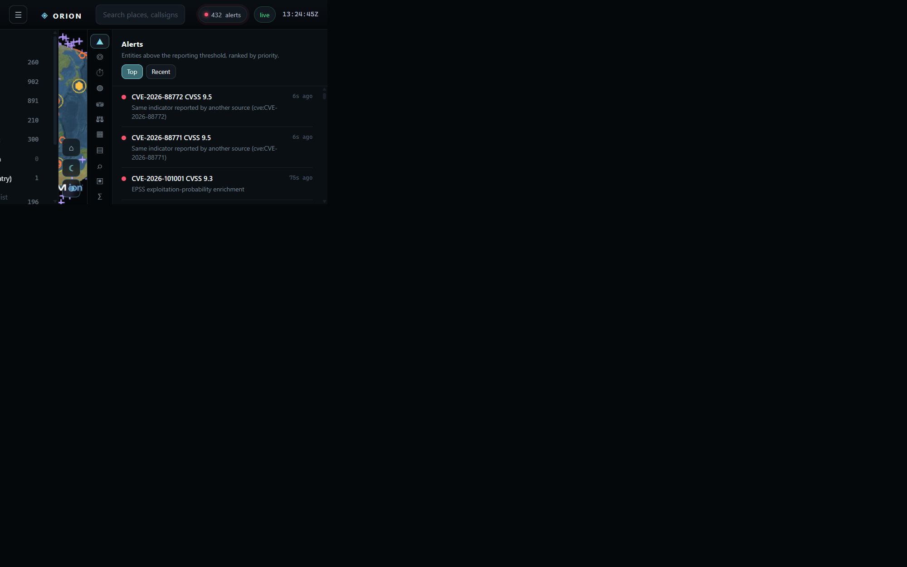
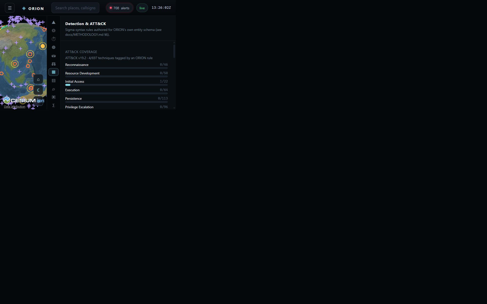

# ORION Intelligence Fabric

A research-grade, open-source-intelligence workstation: a real Cesium globe fed by a dozen live public data
sources, run through an explainable multi-factor fusion engine, with a Sigma-syntax detection engine, an
Analysis-of-Competing-Hypotheses workbench, STIX/TAXII export, and a live analysis graph — no paid APIs, no
external AI calls, runs entirely on your own machine.

**This is a research and portfolio project, not an operational intelligence platform.** See
[`docs/SYSTEM_CARD.md`](docs/SYSTEM_CARD.md) for intended use and [`docs/RESEARCH.md`](docs/RESEARCH.md) for
methodology and limitations.

## What it does

- **Live global data, for real**: aircraft (airplanes.live/adsb.lol), AIS vessels in the Baltic (Digitraffic),
  satellites propagated with real SGP4 (CelesTrak + satellite.js), earthquakes and natural hazards (USGS, NASA
  EONET), botnet C2 infrastructure (abuse.ch), media attention (GDELT), and vulnerabilities (NVD, CISA KEV,
  FIRST EPSS) — see the full table below.
- **A fusion engine you can audit**: every entity's priority is broken into six named, weighted factors
  (severity, criticality, source reliability, credibility, freshness, corroboration), each with a plain-English
  reason, an Admiralty grade (NATO STANAG 2511), and ICD 203 estimative language. Full formulas in
  [`docs/METHODOLOGY.md`](docs/METHODOLOGY.md).
- **A real 3D globe**: CesiumJS, NASA GIBS true-colour imagery, real day/night terminator, real orbital ground
  tracks and satellite passes — not a canvas gradient.
- **Sigma-syntax detection**: a from-scratch condition-grammar engine, its YAML reader differentially tested
  against PyYAML on all 3,144 public SigmaHQ rules with zero divergence; 14 rules shipped against ORION's own
  schema, cross-checked at load time against the real MITRE ATT&CK dataset (697 techniques).
  See `docs/METHODOLOGY.md §7`.
- **STIX 2.1 / TAXII 2.1**: real SDOs (indicator, vulnerability, malware, location, sighting, relationship)
  where the schema maps cleanly, clearly-labelled `x-orion-*` extensions where it doesn't.
- **ACH workbench**: Heuer's Analysis of Competing Hypotheses, ranking by least inconsistency, with a fragile-
  evidence check.
- **A live analysis graph, a case builder, passive-only recon** (RDAP / crt.sh / DoH / Shodan InternetDB —
  never a packet sent to the target itself), and a synthetic benchmark harness reporting AUROC, calibration
  (ECE), and ablations for the fusion model itself.
- **Offline mode**: set `ORION_MODE=offline` and the whole app runs on a deterministic synthetic scenario,
  clearly marked as synthetic everywhere it appears — no internet connection required, useful for demos and CI.

## Screenshots





## Quickstart

Requires Node.js 22 or newer.

```bash
npm install
npm start                    # http://127.0.0.1:8787
```

Or in VS Code: open this folder, then **Run and Debug → "ORION: Run (live)"** (or **"…(offline / synthetic)"**
to run with no internet at all), or use **Terminal → Run Task → "Run (live)"**. `.vscode/` ships launch
configs, tasks, and recommended extensions.

On Windows without a terminal handy, double-click `run.bat` (or `run.ps1` in PowerShell) — either installs
dependencies on first run and starts the server.

```bash
npm run dev          # offline/synthetic mode, debug logging
npm test             # syntax check + unit tests + a full offline smoke test of the API
npm run check        # syntax-check every server/shared/client file
```

Copy `.env.example` to `.env` to configure anything — every setting has a working default, nothing is required.
A free [Cesium ion](https://ion.cesium.com) token (`CESIUM_ION_TOKEN`) additionally enables real-world terrain
and OSM 3D buildings; without one the globe still renders in full detail on bundled imagery + NASA GIBS.

### Docker

```bash
docker compose up --build    # http://127.0.0.1:8787
```

## Live data sources

| Source | Layer | License / terms | Auth |
|---|---|---|---|
| USGS Earthquake Hazards | Seismic | Public domain (US Gov) | none |
| NASA EONET | Natural hazards | Public domain, cite source | none |
| airplanes.live / adsb.lol / adsb.one | Aircraft | Non-commercial use | none |
| OpenSky Network | Aircraft (off by default) | Research/non-commercial | optional OAuth2 |
| Fintraffic Digitraffic Marine | Vessels (Baltic/Finland only) | CC BY 4.0 | none |
| CelesTrak GP data | Satellites (real SGP4 propagation) | Free for research use | none |
| GDELT Project GEO 2.0 | Media attention | Open, cite GDELT | none |
| abuse.ch Feodo Tracker | Botnet C2 | CC0 | none |
| CISA KEV catalog | Vulnerabilities | Public domain (US Gov) | none |
| NIST NVD | Vulnerabilities | Public domain (US Gov) | optional API key |
| FIRST.org EPSS | Vulnerability enrichment | Free, cite FIRST | none |
| RDAP / crt.sh / Cloudflare DoH / Shodan InternetDB | Passive recon (on demand) | Public services | none |

Plus static reference data: Natural Earth (public domain), OurAirports (public domain), the WRI Global Power
Plant Database (CC BY 4.0), and MITRE ATT&CK Enterprise (Apache-2.0-adjacent, ATT&CK® is a registered trademark
of MITRE). Full attribution and manifest: `data/reference/MANIFEST.json` and `docs/SYSTEM_CARD.md`.

Every adapter declares its own license, coverage, refresh cadence and caveats — see them live at
`GET /api/sources`, or in the **Sources** tab in the app.

## Architecture

```
server/adapters/*   one file per source: parse() is pure & unit-testable, run(ctx) does the fetching
        ↓
server/core/entity.js       normalizes every source into one canonical shape
server/core/store.js        in-memory store, per-source replacement, versioned per layer
server/core/fusion.js       the six-factor score + corroboration + criticality (docs/METHODOLOGY.md)
server/core/alerts.js       ranked, deduplicated alerts with reasons
        ↓
server/routes/*.js          ~40 REST endpoints + one SSE stream, see below
        ↓
client/js/                  vanilla ES modules, Cesium globe + 11 panels, no framework, no bundler
```

More detail, including the shared/ pure-function core (scoring, admiralty grading, geo, orbital mechanics, ACH,
graph algorithms — all independently unit-tested and reused byte-for-byte on both server and client) is in
[`docs/ARCHITECTURE.md`](docs/ARCHITECTURE.md).

## API surface (selected)

`GET /api/health` `/api/layers` `/api/layer/:id` `/api/entity/:id` `/api/feed` `/api/alerts` `/api/search?q=`
`/api/timeline` `/api/graph/overview` `/api/attack/matrix` `/api/stix/export` `/api/taxii/discovery`
`/api/orbit/:norad/path` `/api/briefing` `/api/kev` `/api/cve/:id` · `POST /api/detection/evaluate`
`/api/ach/evaluate` `/api/recon/passive` `/api/case/compose` · `GET /api/stream` (Server-Sent Events).
The full list is wired in `server/app.js` → `server/routes/*.js`.

## Documentation

- [`docs/METHODOLOGY.md`](docs/METHODOLOGY.md) — the fusion formula, Admiralty grading, detection engine, ACH, benchmark methodology
- [`docs/ARCHITECTURE.md`](docs/ARCHITECTURE.md) — module map and data flow
- [`docs/RESEARCH.md`](docs/RESEARCH.md) — research framing, evaluation plan, limitations
- [`docs/THREAT_MODEL.md`](docs/THREAT_MODEL.md) — assets, trust boundaries, mitigations
- [`docs/SYSTEM_CARD.md`](docs/SYSTEM_CARD.md) — intended use, data provenance, risk score caveats
- [`docs/BENCHMARKS.md`](docs/BENCHMARKS.md) — how to read the synthetic benchmark's numbers
- [`docs/PUBLICATION.md`](docs/PUBLICATION.md) / [`docs/DEMO_SCRIPT.md`](docs/DEMO_SCRIPT.md) — presenting this project

## What this is not

Not a SIEM, not a replacement for a licensed CTI platform, not a claim of detection efficacy, not connected to
any classified or paid data source, and not a place to put anyone's personal data. The fusion "priority" score
is a triage aid, not a finding, and every score says so in its own explanation. See `docs/SYSTEM_CARD.md`.

## License

MIT for ORION's own code (`LICENSE`). Bundled/fetched third-party data keeps its own license — see the table
above and `data/reference/MANIFEST.json`.
